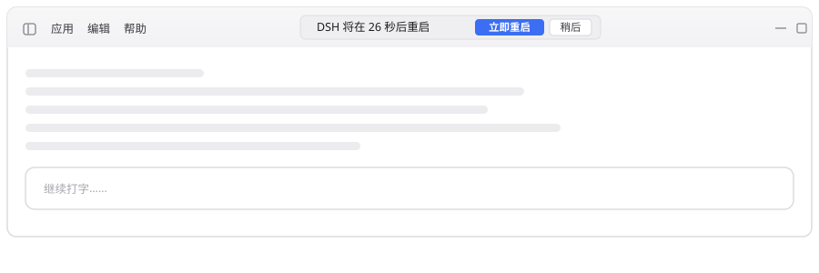

# dsh-restart-relay

**Restart DSH without losing work.**

"Relay" is the point: when DSH has to restart, unfinished work is handed to the next process instead of sending everyone back to the starting line.



---

## What it solves

Plugins, bundles and CLI upgrades in DeepSeek Harness only take effect after the host process restarts. Until now a person had to do that part: the agent stops mid-task, says "please restart, tell me when it's back", you clear the input box, check nothing unsaved is open, close and reopen, then go tell it "done".

Three concrete situations:

- **You're typing** and the agent says it needs a restart. A strip appears at the top counting down, so you can hit "later" and send what you were writing first.
- **You walked away.** The countdown runs out and the restart happens — no confirmation needed from you.
- **You have another conversation running a long task.** That restart used to break it and leave it on "task stopped". Now it gets a note explaining the restart and carries on.

## How it differs from other restart plugins

Most restart plugins are *a button*: click it and the app closes and reopens. Their hard part is "how do I restart".

This one handles **the time around the restart**:

- a **countdown** before anything is killed, instead of acting immediately
- a countdown length taken from **this machine's measured cost**, not a guessed constant
- **a continuation prompt queued for every session that was working**, so those tasks resume afterwards

If all you want is a restart button, something else will be simpler. If you want "the agent restarts itself and then picks its own work back up", this is that.

---

## Three behaviours

| What you do | What happens |
|---|---|
| Click "restart now" | Restarts immediately |
| Click "later" | **Never** restarts on its own; the task stays suspended until you say go |
| Do nothing | Restarts when the countdown reaches zero |

The strip sits at the top of the page, 24px tall. It doesn't cover content or steal focus — you can keep typing and changing settings underneath it.

## The countdown is not a fixed number

It starts at 60 seconds.

After each restart, the plugin reads back this machine's **actual** "kill the tree → the new process answers on its port" duration from the restarter's log, takes the slowest of the last five runs, adds 15 seconds of margin, and uses that as the next countdown. The value lives in `~/.dsh/restart-profile.json`.

So it adapts: a slow machine doesn't fail because the countdown was too short, and a fast one doesn't make you wait a full minute.

## Continuations: who gets woken up

Before a restart, the plugin queues a one-shot continuation prompt for every running session:

- **The session that asked for the restart (the one you are talking to)**: always queued, whether it is busy or idle at that moment. It comes back by itself after the reboot instead of waiting for you to nudge it.
- **Other sessions**: queued only if they are mid-turn. Idle conversations are left alone.

The prompt says:

- this restart was **intentional**, and why (the `reason` the caller passed)
- "task stopped / this turn was interrupted" came from that restart — **it is expected, not a fault**
- continue from where you stopped; **do not ask the user**, don't restart the task, don't redo finished steps

This only happens when a restart is actually going ahead (you clicked "now", or the countdown expired). Clicking "later" queues nothing for anyone.

---

## Install

Search `dsh-restart-relay` in the DSH community market and click install.

Or from the command line:

```sh
dsh plugin --profile desktop add github:Yi-qing-dev/dsh-restart-relay
```

Then **restart DSH once** so the plugin loads.

Requires: **Windows** + **DSH Desktop** (the `desktop` profile) + PowerShell (ships with Windows).

> Tested on DSH 0.2.2-rc.5 with Windows 11. `package.json` declares a minimum of DSH ≥ 0.2.0.

## Usage

Ask the agent to restart, or let it recognise a change that needs one. It calls the `restart_guard` tool:

```
restart_guard action:"request" reason:"installed a plugin update"
```

The tool writes the request, starts a background restarter that waits for approval, and the strip appears on the page.

Other actions: `approve` (now), `defer` (later), `status`.

---

## What it actually does

"Restart" here means **close DSH and open it again** — the same thing as quitting it yourself and double-clicking the icon. The difference is that everything worth notifying gets notified first.

One restart, step by step:

1. Writes `~/.dsh/restart-request.json`
2. Starts a PowerShell through **Windows Task Scheduler**, so it is not inside DSH's process tree — otherwise closing DSH would close the restarter too, and nobody would be left to reopen it
3. The restarter waits for `~/.dsh/restart-approved`, written when you click "now" or when the countdown expires
4. Closes DSH's process tree
5. Relaunches **the executable that is currently running**, with stdout/stderr redirected to `~/.dsh/dsh-stdout.log` / `dsh-stderr.log`
6. **Polls a local port until it actually answers** (not a fixed sleep), up to 3 attempts
7. Records the measured duration in `restart-profile.json`
8. Cleans up its task and any leftover console window on the next boot

Files written (all under `~/.dsh/`):

| File | Contents |
|---|---|
| `restart-request.json` | the pending request, including `reason` |
| `restart-approved` | approval marker; the restarter acts only when it exists |
| `restart-profile.json` | measured duration and samples |
| `restart-supervisor.log` | full log of every restart |
| `restart-guard-boot.log` | plugin boot diagnostics |

---

## Troubleshooting

Start with these two logs — they answer most questions directly:

```
~/.dsh/restart-guard-boot.log    did the plugin itself load?
~/.dsh/restart-supervisor.log    what happened during each restart
```

| Symptom | Where to look |
|---|---|
| **No strip appears at all** | `restart-guard-boot.log`: is there both `apply entered` and `tools.register returned`? Only `apply entered` means the plugin threw while starting |
| **Countdown finished but DSH did not restart** | `restart-supervisor.log`, search for `no restart request and no approval` (request lost), `approval timeout` (gave up waiting), `no Electron main process found`, or `could not read the running executable path` |
| **Security software blocked it** | Allow it and tick "remember this action". In the log the run usually stops after `waiting up to 90s for approval` with nothing following |
| **DSH did not come back** | In `restart-supervisor.log`, is there a `port ready ...` after `relaunching DeepSeek Harness`? If not, start DSH by hand — the log says where it stopped |
| **Clicked "later" and it restarted anyway** | Should not happen. Search the log for `request withdrawn (deferred)`; if that line is missing, defer did not land — please open an issue |
| **Want it gone** | Disable or uninstall the plugin, then delete the `DshSelfRestart` scheduled task (`schtasks /delete /tn DshSelfRestart /f`) and the `restart-*` / `restart-approved` files |

---

## Safety

- **It closes DSH and opens it again** — that is what a restart is. If you have unsaved work, the countdown is your buffer, and clicking "later" stops it from touching anything.
- A **PowerShell / terminal window** appears during the restart, but it is shrunk to 380×96, parked in the bottom-right corner and pushed to the bottom of the z-order, so it **never covers your windows**; it disappears when the process exits. Keeping it visible is deliberate: a *hidden* PowerShell is exactly the pattern antivirus suites flag and block (Huorong, 360 and friends).
- **If your security software asks**, allow it and tick "remember this action". Otherwise the restart fails.
- It does not talk to the network and sends no data. The only network activity is a loopback `127.0.0.1` route the strip polls for state.
- The restarter reads the running DSH executable path and relaunches exactly that. It never downloads or updates anything.

---

## Known limitations

- **Windows + DSH Desktop (the `desktop` profile) only.** macOS / Linux and the `web` / `tui` profiles are untested.
- That terminal window sits small in the bottom-right corner at the bottom of the z-order (see above); cleanup runs on the next boot, so it can linger until the new process is up.
- The engine itself prints "task stopped / this turn was interrupted" for the turn it cut off. **That message cannot be removed** — it is core behaviour. The continuation prompt exists so the receiving session knows it is expected and keeps working instead of stopping to ask.
- Task Scheduler launches PowerShell under `svchost`. A strict security policy can still block it; when that happens, `restart-supervisor.log` records it.
- Continuation is a **new turn** picking up the work, not a restore of the interrupted turn's in-memory state.
- With several DSH instances on one machine, the restarter acts on the single Electron main process it finds.

---

## License

MIT