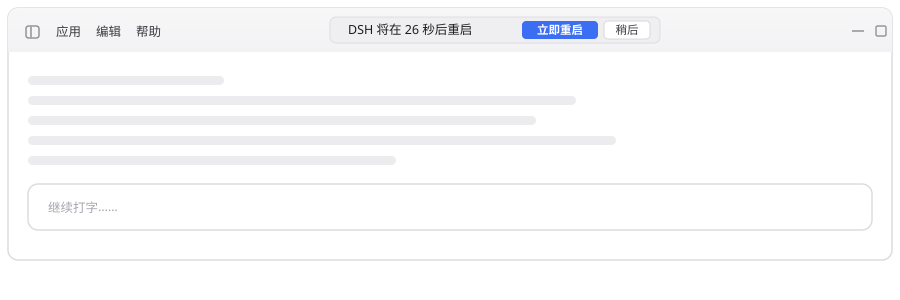

# dsh-restart-relay

**重启 DSH，不丢工作。**

名字里的 "relay" 是接力：DSH 必须重启时，把没做完的活交给下一个进程接着跑，而不是让所有人回起跑线重来。



---

## 它解决什么问题

DeepSeek Harness 的插件、bundle、CLI 版本更新后，要重启宿主进程才能生效。以往这件事得由人来点：AI 干到一半说“请你重启一下，重启完告诉我”，你清空输入框、确认没有未保存的设置、关掉再打开，然后回去告诉它“好了”。

三个具体场景：

- **你在打字**，AI 说要重启。顶部出现横条倒数，你可以先点「稍后」把手上那段发出去。
- **你走开了**，倒计时自己走完，重启照做，不用回来点确认。
- **你有别的对话在干长任务**，这次重启本来会把它打断、停在「任务已停止」。现在它重启后会收到一条说明，自己接着做。

## 跟别的重启插件差在哪

市面上的重启插件大多是「一个按钮」：点了就关、就开。它们的难点在“怎么重启”。

这个插件处理的是**重启前后那段时间**：

- 重启前先给你**倒计时**，而不是立刻动手
- 倒计时长短来自**你这台机器实测的耗时**，不是拍脑袋的固定值
- 重启前后给**正在干活的会话各排一条续接**，让它们的任务接着跑

如果你只是想要一个重启按钮，装别的更省事；如果你要的是“AI 自己重启完还能自己接着干”，这里就是。

---

## 三种行为

| 你的操作 | 结果 |
|---|---|
| 点「立即重启」 | 立刻重启 |
| 点「稍后」 | **永不**自动重启，任务挂起，等你说可以 |
| 什么都不点 | 倒计时结束自动重启 |

横条在页面顶部，24px 高，不遮挡内容、不抢焦点，你可以继续打字和改设置。

## 倒计时不是固定值

第一次运行时用 60 秒。

每次重启后，插件从重启日志里读回这台机器**真实的**「杀进程 → 新进程端口可用」耗时，取最近 5 次里最慢的一次，加 15 秒余量，作为下次的倒计时。设定值存在 `~/.dsh/restart-profile.json`。

用得越多越贴合你的机器：慢机器不会因为倒计时太短而重启失败，快机器也不用干等一分钟。

## 续接：谁会被叫醒

重启前，插件会给**所有正在运行的会话**各排一条一次性续接提示。其中：

- **发起这次重启的会话（也就是你正在说话的这个）**：一定会被排上，不管它当时空闲还是在跑。这样重启完它会自己回来接着干，不需要你催。
- **其他会话**：只排给当时正在跑的。空闲的对话不会被打扰。

续接提示的内容包括：

- 这次重启是**有意为之**，以及原因（发起方传的 `reason`）
- 「任务已停止 / 本轮已中止」是这次重启造成的，**属于预期结果，不是故障**
- 直接接着做，**不要问用户**，不要重开任务，不要重复已完成的步骤

这一步只在**确实要重启**时才做（你点「立即」或倒计时到点）。点「稍后」不给任何人排任务。

---

## 安装

从 DSH 社区市场搜 `dsh-restart-relay`，点安装。

或者用命令行：

```sh
dsh plugin --profile desktop add github:Yi-qing-dev/dsh-restart-relay
```

装完**重启一次 DSH**，插件才会加载。

需要：**Windows** + **DSH Desktop**（`desktop` profile）+ PowerShell（系统自带）。

> 本插件在 DSH 0.2.2-rc.5 / Windows 11 上实测通过；`package.json` 声明的最低要求是 DSH ≥ 0.2.0。

## 用法

对 AI 说「重启一下」，或让它识别出某个必须重启的改动。它会调用 `restart_guard` 工具：

```
restart_guard action:"request" reason:"安装了插件更新"
```

工具会：写请求文件 → 启动后台重启器等待批准 → 页面出现横条。

其余动作：`approve`（立即）、`defer`（稍后）、`status`（看状态）。

---

## 它会做什么

这里的「重启」就是**关掉 DSH 再打开**，跟你手动点关闭、再双击图标是一回事。区别只在于它会先把该通知的都通知到，再动手。

一次重启的完整动作：

1. 插件写 `~/.dsh/restart-request.json`
2. 用 **Windows 计划任务**启动一个 PowerShell，它不在 DSH 的进程树里（否则关掉 DSH 时会把自己一起关掉，重启就没人执行了）
3. 重启器等待 `~/.dsh/restart-approved`（你点「立即」，或倒计时到点自动批准）
4. 关闭 DSH 的进程树
5. 用**当前正在运行的那个可执行文件**重新启动 DSH，stdout/stderr 重定向到 `~/.dsh/dsh-stdout.log` / `dsh-stderr.log`
6. **轮询本机端口直到真的能连上**（不是固定等几秒），最多重试 3 次
7. 把实测耗时写入 `restart-profile.json`
8. 下次启动时清理本次的计划任务和残留终端窗口

写出的文件（都在 `~/.dsh/`）：

| 文件 | 内容 |
|---|---|
| `restart-request.json` | 待批准的请求（含 reason） |
| `restart-approved` | 批准标记，重启器看到才动手 |
| `restart-profile.json` | 本机实测耗时与样本 |
| `restart-supervisor.log` | 每次重启的完整日志 |
| `restart-guard-boot.log` | 插件启动诊断 |

---

## 出问题怎么办

先看这两个日志，绝大多数问题都能直接定位：

```
~/.dsh/restart-guard-boot.log    插件本身有没有加载成功
~/.dsh/restart-supervisor.log    每台重启的完整过程
```

| 现象 | 查什么 |
|---|---|
| **横条根本不出现** | `restart-guard-boot.log` 里有没有 `apply entered` 和 `tools.register returned`。只有 `apply entered` 说明插件启动时抛错了 |
| **倒计时走完但 DSH 没重启** | `restart-supervisor.log` 搜这几行：`no restart request and no approval`（请求丢了）、`approval timeout`（等批准超时）、`no Electron main process found`（没找到 DSH 进程）、`could not read the running executable path`（读不到可执行文件路径） |
| **安全软件弹窗拦截** | 选「允许」并勾「记住本次操作」。被拦时日志里通常停在 `waiting up to 90s for approval` 之后没有下文 |
| **重启后 DSH 没起来** | `restart-supervisor.log` 里看 `relaunching DeepSeek Harness` 之后有没有 `port ready ...`。没有的话手动启动一次 DSH，日志已经说明卡在哪 |
| **点了「稍后」但过一会儿还是重启了** | 不该发生。日志里搜 `request withdrawn (deferred)`，没这行说明 defer 没写成功，请报 issue |
| **想彻底停用** | 停用或卸载插件，然后删掉 `DshSelfRestart` 计划任务（`schtasks /delete /tn DshSelfRestart /f`）和上面几个 `restart-*.json` / `restart-approved` 文件 |

---

## 安全提示

- **它会关闭 DSH 再重新打开**，这是重启的定义。如果你有未保存的工作，横条上的倒计时就是留给你的缓冲；点「稍后」它就不动手。
- 重启时会出现**一个 PowerShell / 终端窗口**，但会被缩到 380×96、钉在屏幕右下角并压到最底层，**不会盖住你任何窗口**；进程退出时它自己消失。窗口保持可见是有意为之：隐藏的 PowerShell 正是安全软件（火绒、360 等）判定为可疑并拦截的模式。
- **如果安全软件弹出拦截提示**，请选择**允许**并勾选「记住本次操作」。否则重启会失败。
- 它不联网、不发送任何数据。唯一的网络动作是本机的 `127.0.0.1` HTTP 路由，供页面横条轮询状态。
- 重启器会读取当前 DSH 进程的可执行路径并原样重新启动，不会执行下载或更新。

---

## 已知限制

- **仅 Windows + DSH Desktop（`desktop` profile）**。macOS / Linux、`web` / `tui` profile 均未验证。
- 重启期间那个终端窗口缩在右下角最底层（见上）；清理发生在下次启动时，所以它最多存在到新进程起来为止。
- 引擎自己会为被打断的 turn 打一条「任务已停止，本轮已中止」。**这条无法消除**——它是内核行为。续接提示的作用是让收到它的会话知道这是预期结果，从而继续工作而不是停下来询问。
- 计划任务由 `svchost` 拉起 PowerShell。极少数安全策略可能仍然拦截，此时会在 `restart-supervisor.log` 留下痕迹。
- 续接是**新一轮**接着做，不是恢复被打断那轮的内存状态。
- 一台机器上用多个 DSH 实例时，重启器默认只处理它找到的那一个 Electron 主进程。

---

## 许可

MIT